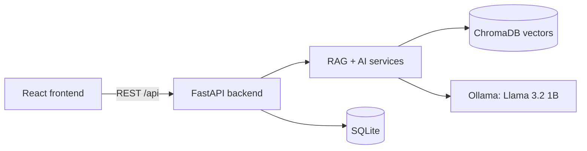

# StudyMate AI – AI-Powered Personal Learning Assistant

Upload your lecture PDFs and study them with a **local** AI: ask questions with page-referenced answers, get summaries, generate quizzes and flashcards. Everything (language model, embeddings, vector search, database) runs on your own computer. No paid APIs, no cloud, your documents never leave the machine.

## Features
- PDF upload with validation (real PDF check, 20 MB limit, password-protected / corrupted / image-only PDFs handled)
- **Real RAG**: page-aware chunking → local embeddings → ChromaDB similarity search → grounded prompt → Ollama answer with sources
- Honest "not enough information" answers (the model is not even called when nothing relevant is found)
- AI chat with multi-document selection, saved conversations, source excerpts and page numbers
- Short / detailed summaries (map-reduce for long PDFs), key concepts, definitions, exam notes
- Multiple-choice quizzes (Easy/Medium/Hard), validated JSON, server-side scoring, answers hidden until submission
- Flashcards with flip animation, known / revise tracking saved to the database
- Dashboard with study statistics, settings page with live service status

## Technology
| Layer | Tools |
|---|---|
| Frontend | React 18, Vite, TypeScript, Tailwind CSS 4, React Router, TanStack Query, Axios, Lucide |
| Backend | Python 3.11/3.12, FastAPI, Uvicorn, Pydantic v2, SQLAlchemy 2 |
| AI | Ollama + Llama 3.2 1B (chat), Sentence Transformers all-MiniLM-L6-v2 (embeddings) |
| Storage | ChromaDB (vectors, persistent), SQLite (relational) |
| PDF | PyMuPDF |
| Tests | Pytest + FastAPI TestClient, Vitest + React Testing Library |

## Architecture

More diagrams: [docs/ARCHITECTURE.md](docs/ARCHITECTURE.md).

## Quick start
Full instructions (Windows/macOS/Linux, low-RAM troubleshooting): [docs/INSTALLATION.md](docs/INSTALLATION.md).

```bash
# 1. Local model (once)
ollama pull llama3.2:1b

# 2. Backend (terminal 1)
cd backend
python -m venv .venv
.venv\Scripts\activate          # macOS/Linux: source .venv/bin/activate
pip install -r requirements-dev.txt
copy .env.example .env          # macOS/Linux: cp .env.example .env
python scripts/download_embedding_model.py   # once, needs internet
uvicorn app.main:app --port 8000

# 3. Frontend (terminal 2)
cd frontend
npm install
npm run dev
```
Open http://localhost:5173 (API docs: http://localhost:8000/docs).

## Tests
```bash
cd backend && pytest          # backend (no Ollama / model download needed)
cd frontend && npm test       # frontend
python backend/scripts/manual_integration_test.py some.pdf   # real model, manual
```
See [docs/TESTING_REPORT.md](docs/TESTING_REPORT.md).

## Documentation
`docs/` contains the academic report, architecture, installation, API reference, testing report, 50+ viva questions and demo scripts.

## Screenshots
_Add screenshots of Dashboard, Documents, Chat (with sources), Quiz and Flashcards here after your first run._

## Acknowledgements and open-source references
FastAPI, React, Vite, Tailwind CSS, TanStack Query, SQLAlchemy, Pydantic, PyMuPDF, ChromaDB, Sentence Transformers (all-MiniLM-L6-v2), Ollama and Meta's Llama 3.2 model. Each is used under its own licence; check the licence of the Llama model before redistributing it.
