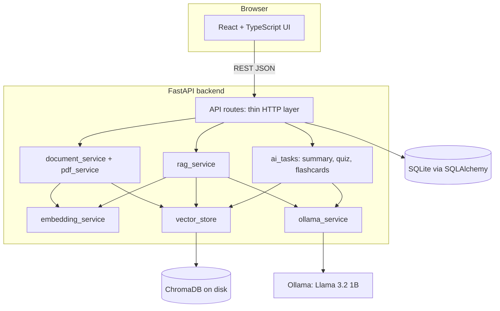
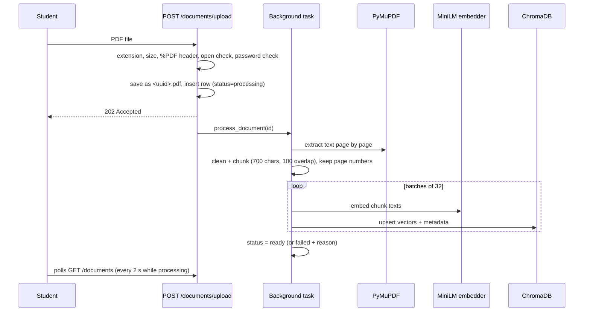
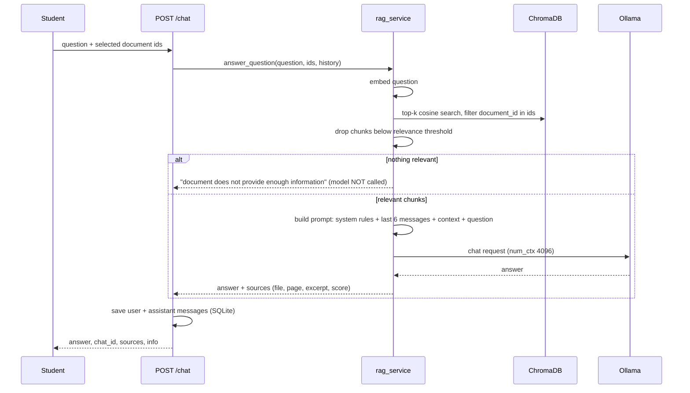
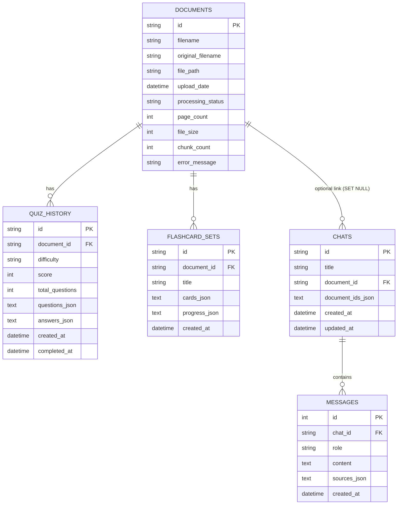
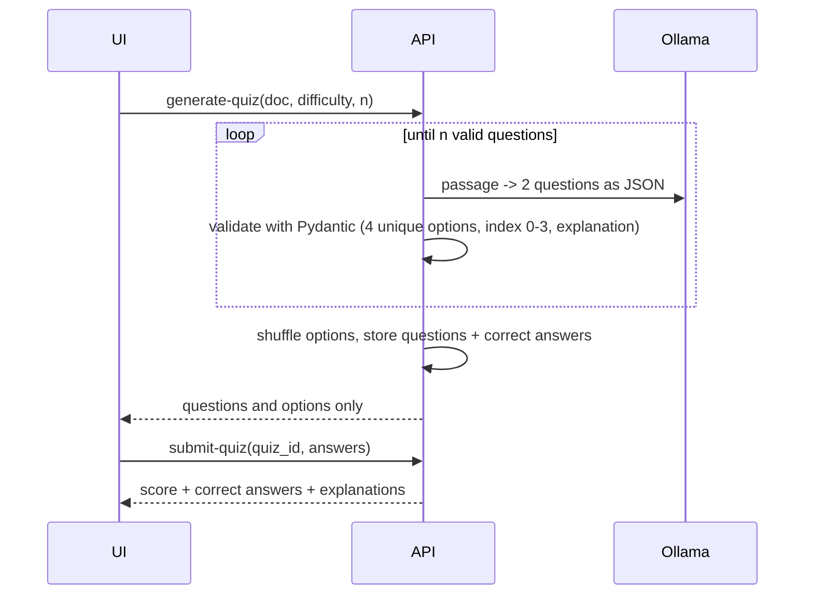
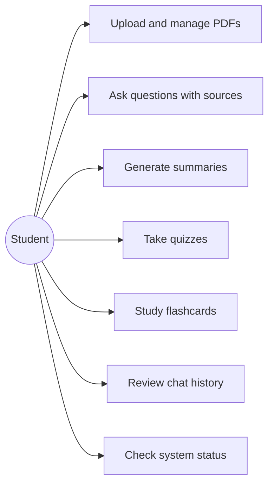

# Architecture

## 1. System overview

Routes only translate HTTP to function calls and back. All logic lives in `app/services`, which does not import FastAPI, so it can be tested alone.
Long-document summaries group up to three sections per model request, and quiz requests generate up to three questions at a time to reduce serial model round trips.

## 2. Folder map
```
backend/app/
  api/        routes (system, documents, chat, ai, analytics) + deps
  core/       settings (config.py)
  db/         engine/session (database.py), tables (models.py)
  schemas/    Pydantic request/response + LLM output validators
  services/   pdf, text_utils, embedding, vector_store, ollama, rag, ai_tasks, document
frontend/src/
  pages/      one file per sidebar item
  components/ Layout (sidebar), DocumentPicker, ui primitives
  lib/        api.ts (all HTTP calls + types), utils.ts
```

## 3. Document ingestion


## 4. RAG question answering


## 5. Database (SQLite)

Vectors live in ChromaDB (not SQLite). Each vector's metadata: `document_id`, `filename`, `page_number`, `chunk_index`. Deleting a document removes the SQLite row (cascading to quizzes and flashcards), the PDF file and all its vectors.

## 6. Quiz flow (answers stay on the server)


## 7. Use cases


## 8. Design decisions
- **Page-aware chunks**: chunking is done per page so every passage can cite its page.
- **Relevance threshold**: weak matches are discarded; with no matches the model is not called, which prevents invented answers.
- **Small context**: at most `TOP_K` passages, 3000 characters of context and 6 history messages go to the 1B model.
- **Background processing**: upload returns immediately; the UI polls the status.
- **Lazy model loading**: the embedding model loads on first use, Ollama unloads the chat model after `OLLAMA_KEEP_ALIVE`.
- **JSON mode + validation**: small models produce imperfect JSON, so every question/card is validated individually and bad ones are dropped.
