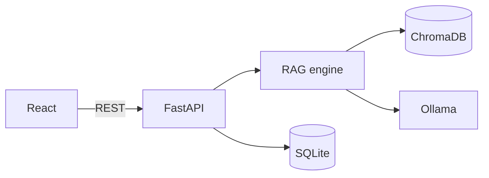
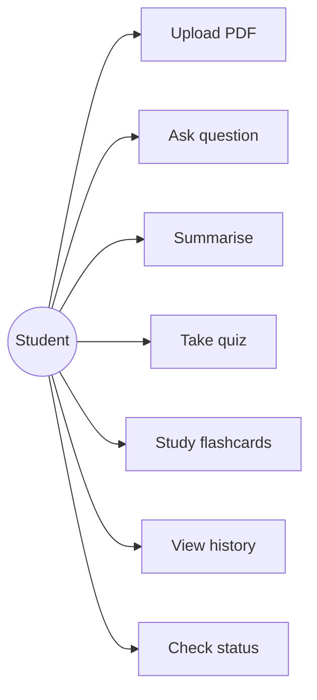

# StudyMate AI: AI-Powered Personal Learning Assistant

## 1. Title page
**Project:** StudyMate AI, individual academic project (RK2)
**Student:** [Your full name]  **Group:** [Group]
**Course:** [Course name]  **Supervisor:** [Name]
**University:** Al-Farabi Kazakh National University
**Year:** 2026

## 2. Abstract
StudyMate AI is a locally deployed web application that lets students upload lecture PDFs and study them with artificial intelligence. It uses Retrieval-Augmented Generation (RAG): PDF text is extracted page by page, split into overlapping chunks, converted to embeddings with a Sentence Transformers model and stored in ChromaDB. When a student asks a question, the most relevant chunks are retrieved and passed to a small local language model (Llama 3.2 1B, run by Ollama), which answers using only that context and returns page references. The system also generates summaries, multiple-choice quizzes with server-side scoring, and flashcards. A React and TypeScript frontend communicates with a FastAPI backend that stores relational data in SQLite. All inference runs on an 8 GB RAM laptop without paid or cloud services, so documents stay private.

## 3. Introduction
Students receive long lecture documents and need to find, understand and revise information quickly. General-purpose chatbots are not aware of a student's own materials, may invent facts, and usually require sending documents to external servers. This project builds a private assistant that works on the student's own PDFs.

## 4. Background
Large language models (LLMs) are neural networks based on the Transformer architecture (Vaswani et al., 2017) that generate text. They have a fixed knowledge and can produce plausible but false statements ("hallucination"). Retrieval-Augmented Generation (Lewis et al., 2020) reduces this by retrieving relevant documents and giving them to the model together with the question. Retrieval relies on text embeddings: vectors in which similar meanings are close (Reimers and Gurevych, 2019, Sentence-BERT). Small open models can now run locally through tools such as Ollama.

## 5. Problem statement
How can a student obtain accurate, source-referenced help from personal study materials using only a modest laptop (8 GB RAM, no GPU), without paid cloud AI, while keeping the documents private?

## 6. Project objectives
1. Build a full-stack web application for uploading and managing PDF study materials.
2. Implement a real RAG pipeline with page-aware retrieval and source citations.
3. Generate summaries, quizzes and flashcards grounded in the document.
4. Run all AI inference locally and keep memory usage suitable for 8 GB RAM.
5. Persist data (SQLite, ChromaDB) and provide automated and manual tests and documentation.

## 7. Project scope
**In scope:** text-based PDFs up to 20 MB, English-centred content, single local user, CPU inference, chat, summaries, quizzes, flashcards, dashboard, settings.
**Out of scope:** OCR of scanned documents, user accounts and login, cloud deployment, mobile apps, model training, other file formats.

## 8. Existing system
Cloud chatbots (for example general web assistants) and PDF-chat web services. Strengths: strong models. Weaknesses: documents leave the device, usage cost or limits, internet dependence, answers not always tied to page numbers. Manual study (reading and note-taking) is slow for large documents.

## 9. Proposed system
A local application combining a React interface, a FastAPI backend, a local LLM, a local embedding model, ChromaDB and SQLite. Every answer is generated from retrieved passages, shown with document name, page number and excerpt, and the system refuses honestly when the document lacks the information.

## 10. Literature and technology review
- **Transformers:** Vaswani et al., "Attention Is All You Need", 2017.
- **RAG:** Lewis et al., "Retrieval-Augmented Generation for Knowledge-Intensive NLP Tasks", NeurIPS 2020.
- **Sentence embeddings:** Reimers and Gurevych, "Sentence-BERT", EMNLP 2019. Model used: sentence-transformers/all-MiniLM-L6-v2.
- **Llama 3.2 1B** (Meta) served by **Ollama**.
- **ChromaDB**: open-source embedding database with cosine HNSW index.
- **PyMuPDF**: PDF text extraction. **FastAPI**, **Pydantic**, **SQLAlchemy**, **React**, **Vite**, **Tailwind CSS**, **TanStack Query** for the application.
(Full references in section 29. Verify each reference details before submitting.)

## 11. Functional requirements
FR1 upload PDFs with validation; FR2 list, search and delete documents; FR3 process documents (extract, chunk, embed, store); FR4 answer questions with sources; FR5 filter by one or several documents; FR6 save and reopen conversations; FR7 generate short and detailed summaries; FR8 generate quizzes and score them; FR9 generate flashcards and track progress; FR10 show dashboard statistics; FR11 show service status.

## 12. Non-functional requirements
Privacy (local only), performance on 8 GB RAM, reliability (clear errors, no crashes on bad PDFs), security (safe file paths, size limit, no stack traces to users), maintainability (layered code, configuration via .env), usability (responsive, accessible interface), testability.

## 13. Hardware requirements
Laptop with 8 GB RAM, modern CPU, about 5 GB free disk, no dedicated GPU needed.

## 14. Software requirements
Windows/macOS/Linux, Python 3.11-3.12, Node.js 20+, Ollama, Git, a modern browser. Python packages: see `backend/requirements.txt`; frontend packages: `frontend/package.json`.

## 15. System architecture
See ARCHITECTURE.md. Three tiers: React frontend, FastAPI backend (routes, services), data and AI layer (SQLite, ChromaDB, Ollama, embedding model).

## 16. Use-case diagram

## 17. Database design
Tables: documents, chats, messages, quiz_history, flashcard_sets with foreign keys and indexes (ER diagram in ARCHITECTURE.md). Vectors with metadata (document_id, filename, page_number, chunk_index) are stored in ChromaDB.

## 18. RAG workflow
Ingestion: validate, extract per page, clean, chunk (700/100), embed in batches of 32, store. Query: embed question, top-k cosine search with document filter, threshold 0.25, build prompt (system rules, last 6 messages, up to 3000 characters of context), generate with Ollama, return answer and sources. If no chunk passes the threshold, the model is not called and the system states that the document lacks the information.

## 19. AI model explanation
**Chat model:** Llama 3.2 1B via Ollama, CPU inference, context 4096 tokens, temperature 0.2 for answers. **Embedding model:** all-MiniLM-L6-v2, 384 dimensions, loaded lazily and cached locally. Prompt rules instruct the model not to invent information and to cite pages. JSON mode is used for quizzes, flashcards and summaries, and every output is validated.

## 20. Frontend implementation
React 18 + Vite + TypeScript + Tailwind CSS. Eight pages (Dashboard, My Documents, AI Chat, Summaries, Quiz Generator, Flashcards, Chat History, Settings), a sidebar layout, reusable components, TanStack Query for server state, Axios API client with typed functions. Loading, empty and error states are implemented on every page. Design follows a clean white/light-grey theme with navy text and blue/violet accents.

## 21. Backend implementation
FastAPI application with routers for system, documents, chat, AI tools and analytics. Services: pdf_service, text_utils, embedding_service, vector_store, ollama_service, rag_service, ai_tasks, document_service. Pydantic schemas validate requests and model output. Central exception handlers map Ollama and generation failures to 503/502 and hide internal errors.

## 22. Database implementation
SQLAlchemy 2 ORM models on SQLite with foreign keys enabled (`PRAGMA foreign_keys=ON`), cascade deletes for quizzes, flashcards and messages, and SET NULL for chat-to-document links. Tables are created at startup. Data lives in `backend/data/` and persists across restarts.

## 23. Testing methodology
Pytest with FastAPI TestClient for the backend (temporary data directory, deterministic test embedder, Ollama mocked), Vitest with React Testing Library for the frontend (API module mocked), and a manual integration script for the real local model. Details in TESTING_REPORT.md.

## 24. Actual testing results
**To be completed by the student.** Run `pytest -v`, `npm test` and `npm run build` on your own computer and paste the real output summaries into TESTING_REPORT.md section 4 and here. No results are reported in this document because none have been measured yet.

| Test suite | Tests passed / total | Date | Notes |
|---|---|---|---|
| Backend (pytest) | _fill in_ | | |
| Frontend (vitest) | _fill in_ | | |
| Manual integration | _fill in_ | | |

## 25. Results and discussion
**To be completed after running the system.** Suggested content, using your own measurements: processing time per PDF size, answer time per question, memory use observed in Task Manager during chat, quality of answers for answerable and unanswerable questions, number of valid quiz questions per request. Discuss where the 1B model is weak (long reasoning, exact numbers) and how retrieval threshold and chunk size changed results.

## 26. Limitations
1. Small model: answers can be shallow or wrong, especially for complex questions.
2. No OCR: scanned PDFs are rejected.
3. English-centred embedding model: weak for Kazakh/Russian text.
4. CPU inference is slow (seconds to minutes per generation).
5. Facts spread over many pages may not be retrieved together.
6. No user accounts; one user per installation.
7. Tables, formulas and figures in PDFs are not understood.

## 27. Future improvements
OCR support, multilingual embeddings, hybrid keyword and vector search, re-ranking, streaming answers, larger models on better hardware, user authentication, export of summaries and quizzes, spaced-repetition scheduling for flashcards.

## 28. Conclusion
StudyMate AI demonstrates that a complete RAG-based study assistant can run entirely on a modest laptop. It grounds answers in the student's own documents, shows sources, refuses when information is missing, and adds summaries, quizzes and flashcards, while keeping data private. Final conclusions about quality must be based on the measurements in sections 24 and 25.

## 29. References
1. Vaswani, A. et al. (2017). Attention Is All You Need. Advances in Neural Information Processing Systems 30.
2. Lewis, P. et al. (2020). Retrieval-Augmented Generation for Knowledge-Intensive NLP Tasks. NeurIPS 2020.
3. Reimers, N. and Gurevych, I. (2019). Sentence-BERT: Sentence Embeddings using Siamese BERT-Networks. EMNLP 2019.
4. Sentence Transformers documentation and model card for all-MiniLM-L6-v2: https://www.sbert.net and https://huggingface.co/sentence-transformers/all-MiniLM-L6-v2
5. Ollama documentation: https://ollama.com
6. Meta, Llama 3.2 model information, available through the Ollama library.
7. ChromaDB documentation: https://docs.trychroma.com
8. FastAPI documentation: https://fastapi.tiangolo.com
9. PyMuPDF documentation: https://pymupdf.readthedocs.io
10. SQLAlchemy documentation: https://docs.sqlalchemy.org
11. React documentation: https://react.dev
12. Tailwind CSS documentation: https://tailwindcss.com

*Check the exact titles, authors and access dates before submitting; add any extra sources you really read.*
